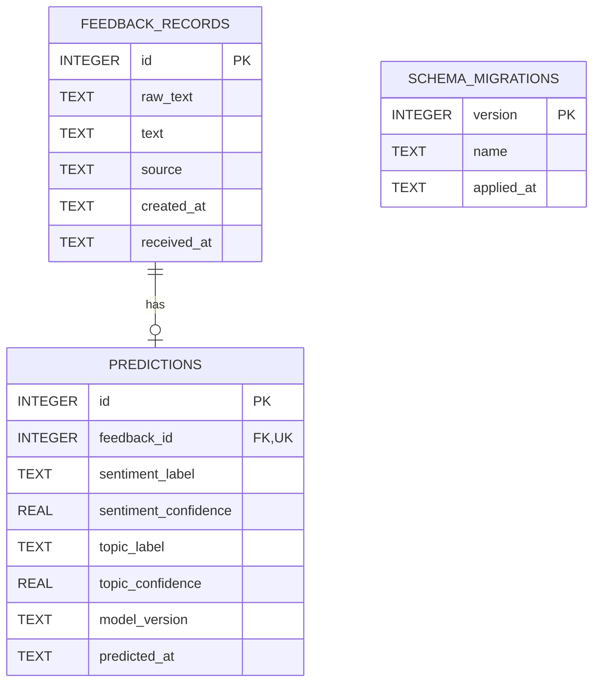

# Database schema và migration

SQLite adapter hiện tại dùng `sqlite3` của Python, connection riêng mỗi operation, `foreign_keys=ON`, busy timeout cấu hình và explicit transactions. Không có connection toàn cục, ORM hoặc PostgreSQL adapter. Định nghĩa thực thi ở [migrations.py](../../backend/app/migrations.py), kết nối ở [database.py](../../backend/app/database.py), truy vấn ở [repository.py](../../backend/app/repository.py).



## Fields và constraints

| Bảng/field | Quy tắc |
| --- | --- |
| feedback_records.id | INTEGER PRIMARY KEY AUTOINCREMENT |
| raw_text | NOT NULL, 1–5000 ký tự; giữ nguyên input mới |
| text | NOT NULL, trimmed length 1–5000; NFC/whitespace normalization do service |
| source | NOT NULL, CHECK manual/batch/csv |
| created_at | Nullable; thời điểm nguồn phản hồi. Input mới được chuẩn hóa UTC |
| received_at | NOT NULL; server nhận vào service trước inference |
| predictions.id | INTEGER PRIMARY KEY AUTOINCREMENT |
| feedback_id | NOT NULL, UNIQUE, FK feedback_records.id, ON DELETE CASCADE |
| sentiment_label | CHECK negative/neutral/positive |
| topic_label | CHECK lecturer/training_program/facility/others |
| confidences | NOT NULL, CHECK trong [0,1]; service còn từ chối NaN/infinity |
| model_version | NOT NULL, không rỗng |
| predicted_at | NOT NULL; UTC timestamp sau khi inference kết thúc |

Timestamp được lưu TEXT theo ISO 8601 UTC với microseconds; mới tạo bởi service. SQLite không tự validate mọi định dạng timestamp. `created_at` lịch sử được giữ nguyên, có thể có định dạng cũ/naive. Date filters chỉ dùng predicted_at đã được migration chuẩn hóa.

Giữ quan hệ 1 feedback–1 prediction để API hiện có đơn giản và không đếm trùng trong dashboard. Database cho phép feedback chưa có prediction, nhưng luồng service mới luôn ghi cả hai atomic; legacy feedback orphan vẫn được bảo toàn và không xuất hiện trong JOIN dashboard. Muốn hỗ trợ re-predict/history cần migration 1:N, current-prediction pointer hoặc query chọn prediction hiện hành; chưa triển khai.

## Indexes và query patterns

- Unique index từ predictions.feedback_id cho JOIN và detail lookup.
- `idx_predictions_sentiment(sentiment_label, predicted_at, feedback_id)`.
- `idx_predictions_topic(topic_label, predicted_at, feedback_id)`.
- `idx_predictions_time(predicted_at, feedback_id)`.

Đọc danh sách dùng count và page query trong cùng read transaction. Dashboard dùng GROUP BY sentiment/topic và count source timestamps. Export dùng LIMIT max+1 để phát hiện vượt giới hạn; không đưa mọi row vào Python chỉ để phân trang. Query values luôn parameterized; SQL identifiers trong code là hằng cố định.

## Migration versions

`schema_migrations(version PRIMARY KEY, name NOT NULL, applied_at NOT NULL)` ghi các revision đã áp dụng.

1. **initial**: nhận diện/tạo schema legacy bằng CREATE IF NOT EXISTS.
2. **feedback_metadata**: rebuild hai bảng với raw_text, received_at, constraints, UTC timestamps và indexes; giữ IDs và AUTOINCREMENT sequence.

Migration chạy trong một `BEGIN IMMEDIATE`, dùng các statement riêng, không dùng executescript tự commit giữa chừng. Nếu bất kỳ bước hoặc foreign-key check lỗi, rollback toàn migration, không để schema nâng cấp một phần. Revision lạ/mới hơn làm ứng dụng từ chối chạy. Thêm revision mới thay vì sửa revision đã áp dụng.

Legacy raw_text không thể khôi phục: được backfill từ text đã chuẩn hóa. received_at được backfill từ predicted_at nếu có, nếu không thì thời điểm migration; đây không phải bằng chứng thời điểm nhập gốc. Legacy predicted_at thiếu timezone được diễn giải theo UTC+07:00 theo quy ước ứng dụng cũ; cần review dữ liệu ngoài nguồn này trước migration. Không tự truncate bản ghi >5000 ký tự hoặc sửa nhãn sai để vượt constraint: migration sẽ dừng và operator phải xử lý có chủ đích.

## Vận hành

Từ project root, kích hoạt virtualenv và đặt DATABASE_PATH nếu cần:

```powershell
python -m backend.app migrate
python -m backend.app serve
```

`AUTO_MIGRATE=true` mặc định development; production mặc định false và phải migrate trước startup. CLI đọc settings environment như ứng dụng. Lệnh migrate có thể nâng cấp database thật đang cấu hình: kiểm tra resolved path và backup trước khi chạy. Công việc triển khai code này chỉ chạy migration trên database tạm trong tests, không nâng cấp database runtime của người dùng.

Trước nâng cấp dữ liệu quan trọng: dừng API, tạo backup nhất quán bằng SQLite backup API hoặc quy trình đã kiểm chứng, chạy migration, verify schema/record counts và smoke test rồi mới nhận traffic. Giữ backup để restore khi rollback code; không có down migration tự động. Không sao chép riêng file chính khi một DB WAL vẫn đang có writer.

SQLite mặc định rollback journal trong bản này, không tự bật WAL. Trước khi bật WAL cần kiểm tra SQLite version đã vá, filesystem cùng host và backup/checkpoint policy. Khi cần multi-host hoặc writes đồng thời cao, thêm PostgreSQL adapter và migration tương ứng; ports không làm SQL hai engine tự tương thích.
