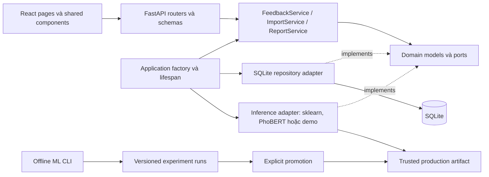

# Thiết kế hệ thống và phạm vi triển khai tối giản

## Quyết định kiến trúc

Dùng **modular monolith** với dependency injection và ports/adapters. Triển khai một API process và một database trên máy hiện tại. React là client, ML training là pipeline offline độc lập. Tách service theo tải thực tế sau này, không yêu cầu Redis, message broker hoặc Kubernetes cho demo.

Mục tiêu là ranh giới rõ và hợp đồng được kiểm thử, không phải tuyên bố đạt một chứng nhận hoặc một mức throughput chưa đo. Latency và capacity phải benchmark trên máy triển khai.

## Component và hướng dependency

`domain/` không import FastAPI hoặc SQLite. Application services phụ thuộc repository/predictor ports; adapters thực hiện I/O. Routers chỉ xử lý HTTP và gọi services. App factory lắp các dependency, cho phép inject fake predictor và database tạm khi test. Không nạp model hoặc mở database lúc import module.

Frontend hiện giữ các trang Analyze/Dashboard/Import, shared Header/Badge/BarChart và state navigation. Giao diện hiện dùng thiết kế Góc lắng nghe; không có routing library. Dữ liệu HTTP tiếp tục theo `/api/v1`; một API client dùng chung và OIDC UI là các extension riêng.

## Luồng dữ liệu

### Một phản hồi và batch

1. Request đi qua request ID, optional bearer authentication và Pydantic validation.
2. Service giữ `raw_text`, tạo normalized `text` bằng NFC/whitespace, gọi predictor ngoài database transaction.
3. Kiểm tra nhãn, confidence và model version từ predictor trước khi ghi.
4. Repository ghi feedback và prediction trong một transaction ngắn; batch ghi tất cả sau khi suy luận thành công, giữ thứ tự đầu vào.
5. Response giữ các field cũ và bổ sung raw text; không trả stack trace.

### CSV

Upload có giới hạn byte và số dòng. Header kiểm tra độc lập với dòng đầu. Cùng schema text/date như request đơn; lỗi dữ liệu được báo theo dòng. Các dòng hợp lệ được dự đoán, rồi ghi chung một transaction. Lỗi model/database không được giả làm lỗi dữ liệu từng dòng. CPU inference chạy trong sync worker thread, không chặn event loop trong async handler.

### Đọc và báo cáo

Repository thực hiện `COUNT`, `LIMIT/OFFSET` và `GROUP BY` trong SQL. Cùng filter object cho danh sách, summary và export. Date range lọc `predicted_at` theo UTC, lower bound inclusive và upper bound exclusive; `created_at` là thời điểm nguồn phản hồi, không tự thay thế cho thời điểm xử lý. CSV escape spreadsheet formulas; PDF có wrapping và pagination. Export vượt giới hạn cấu hình phải trả lỗi rõ, không cắt âm thầm.

## API contract

Giữ các route hiện có, bổ sung đọc một bản ghi và readiness. Chi tiết ở [API design](api-design.md).

| Endpoint | Hành vi |
| --- | --- |
| `GET /health` | Liveness, model version và demo flag; không đọc nội dung feedback |
| `GET /ready` | Kiểm tra DB kết nối được và model đã được lắp |
| `POST /api/v1/predictions` | Validate, predict và persist một phản hồi |
| `POST /api/v1/predictions/batch` | 1–100 phản hồi, atomic persistence và ordered response |
| `POST /api/v1/imports/csv` | Bounded CSV import, kết quả imported/errors theo dòng |
| `GET /api/v1/feedback` | SQL pagination, enum/date filters |
| `GET /api/v1/feedback/{id}` | Một phản hồi cùng prediction |
| `GET /api/v1/dashboard/summary` | SQL aggregation, cùng filter semantics |
| `GET /api/v1/exports/csv` và `/pdf` | Bounded report; đầy đủ trong phạm vi được chấp nhận |

POST routes giữ HTTP 200 để tương thích UI hiện tại. Validation giữ `detail` của FastAPI; lỗi nghiệp vụ có `detail` dễ đọc và request ID header. Không triển khai retry/idempotency key trong MVP: retry POST có thể tạo bản ghi mới và client phải biết giới hạn này.

## Database schema và migrations

Xem [database design](database-design.md). SQLite là adapter local; schema có migration version, foreign keys và indexes. Migration không được xóa database để tạo lại; test nâng cấp từ schema cũ với dữ liệu giữ nguyên. Raw text không thể khôi phục từ lịch sử cũ: migration chỉ backfill bằng text đang có và phải công bố giới hạn đó.

SQLite phù hợp một host, write concurrency có giới hạn; không coi WAL là khả năng multi-host. Bản tối giản dùng connection riêng theo operation và busy timeout. Quyết định bật WAL phải theo SQLite runtime được vá và quy trình backup; không tự bật chỉ để tuyên bố hiệu năng.

## Lifecycle và cấu hình

App startup kiểm tra settings, nạp predictor một lần/process rồi migrate nếu AUTO_MIGRATE bật, sau đó verify schema. Chỉ sau startup thành công mới nhận request. Các test tự tạo app với settings và adapters riêng. Shutdown không để lại connection singleton. Baseline thay qua promote; PhoBERT chọn imported runs trong settings. Cả hai cần restart API.

Development có thể dùng keyword demo; production phải có model thật và token nội bộ. Cấu hình qua process environment, không giả định root `.env` được tự đọc. Single-token auth chỉ phù hợp API nội bộ; hệ thống có tài khoản/quyền theo khoa cần OIDC/JWT và authorization policy riêng.

## Triển khai và mở rộng

**Bản tối giản:** chạy Uvicorn bind loopback, một worker; frontend Vite cho development. Không có thao tác deploy cloud trong công việc này.

**Bước kế tiếp khi cần:** reverse proxy/TLS, frontend static hosting, process supervision và backup SQLite bằng backup API. Chuyển PostgreSQL khi cần nhiều API instance/multi-host hoặc writes tranh chấp; thêm repository adapter, connection pool và migration tương ứng, giữ application ports/API.

**Xử lý dài:** chuyển import/batch lớn sang job queue và worker; thêm job status, idempotency và outbox trước khi hứa retry/delivery guarantees. Giữ request hiện tại nhỏ và synchronous.

**Inference:** PhoBERT CPU adapter đã có qua predictor port, cùng benchmark HTTP tuần tự. Inference service riêng/concurrent load là hướng mở rộng. Một worker hiện tải một bản model; tăng worker tăng bộ nhớ.

**Nghiệp vụ nhiều người dùng:** thêm users/organizations, RBAC và tenant key trong schema/repository; chưa có multi-tenancy trong bản hiện tại. Không thêm tenant filter giả vào client rồi coi đó là isolation.

## Validation và giới hạn

Kiểm thử domain/service, repository SQL, transaction rollback, migration upgrade và HTTP dùng app factory/database tạm. Kiểm tra OpenAPI/contract và tương thích artifact ML. Không dùng production database để test. Chưa có load test, OIDC, PostgreSQL adapter, queue, metrics server hoặc frontend e2e; các phần đó là lộ trình, không phải tính năng đã triển khai.

## Tham khảo kỹ thuật

- [FastAPI lifespan](https://fastapi.tiangolo.com/advanced/events/): quản lý tài nguyên startup/shutdown.
- [Python sqlite3](https://docs.python.org/3.11/library/sqlite3.html): connections, transaction và backup.
- [SQLite WAL](https://www.sqlite.org/wal.html): concurrency, giới hạn cùng host và runtime considerations.
